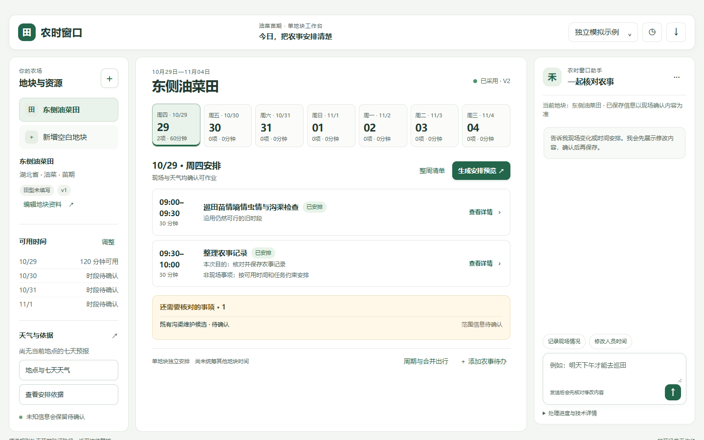
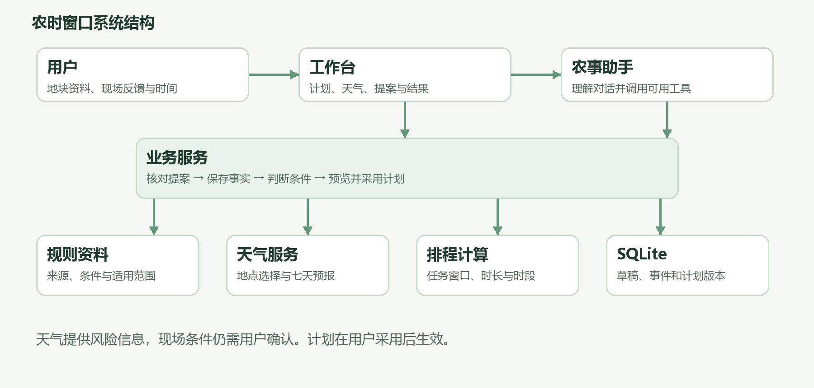
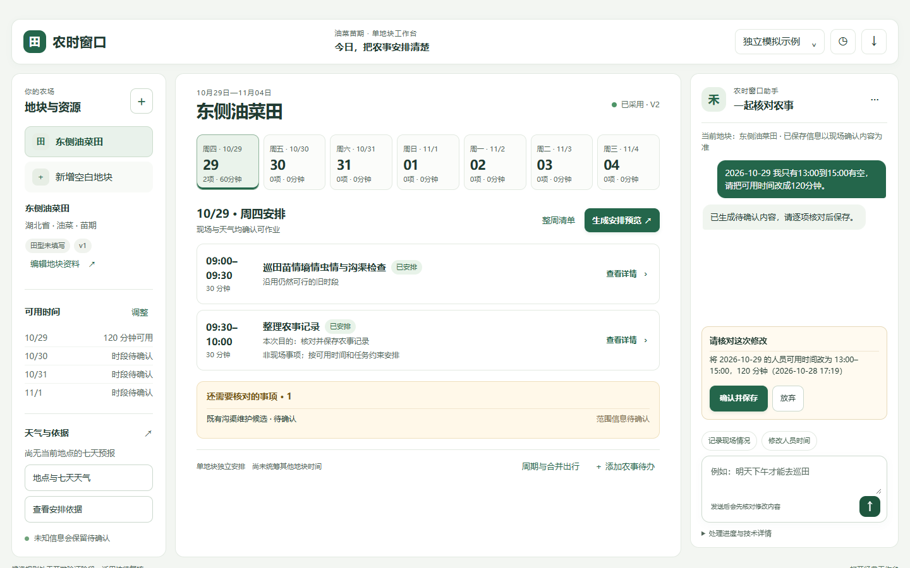

# 农时窗口开发说明

油菜苗期农事规划助手

## 作品简介

农时窗口面向油菜苗期的日常田间管理，帮助使用者整理地块信息、现场观察、天气和可用时间，生成七天农事计划。用户可通过表单或自然语言补充情况，核对依据与缺项后确认安排；现场反馈或时间变化时，系统重新计算并展示调整内容，用户决定是否采用。系统保存任务结果、计划版本和来源信息，便于回顾与交流。

作品面向需要安排巡田和既有沟渠维护等工作的单人使用场景。它关注“先做什么、什么时候做、依据是什么、变化后怎样调整”，让计划与真实可用时间相衔接。

## 功能与使用流程

| 功能 | 用户可以完成的操作 |
| --- | --- |
| 地块档案 | 新建、编辑和切换地块，记录作物、生育期和现场条件 |
| 农事安排 | 设置巡田周期或自定义事项，补充时长、期限和可用时段 |
| 天气与依据 | 选择天气查询点，查看预报及农业资料原文、来源和适用范围 |
| 现场记录 | 从任务进入结果表单，分别记录完成情况、观察和问题 |
| 计划调整 | 反馈变化后查看调整预览，确认采用；历史和清单可导出 |
| 农事助手 | 使用自然语言提出修改，核对提案后保存，也可继续使用表单 |

一次典型操作从地块建档开始：用户填写湖北某模拟地块的油菜苗期信息，确认需要巡田，再提供能够作业的时段。系统依据已确认条件生成七天计划；用户采用后，可从具体任务记录现场结果。如果发现积水或沟渠问题，系统保留观察事实，并在维护目的、需求和作业条件确认后生成相应候选。复查和时间变化会进入后续调整预览。



## 技术结构与特点



工作台由 Streamlit 承载 HTML、CSS 和 JavaScript 界面；Python 业务服务负责地块与事实管理、规则条件判断、任务生成和排程；SQLite 保存草稿、现场事件与计划版本。DeepSeek 用于理解用户表达和选择工具，Open-Meteo 提供地点查询及七天天气预报。

系统先识别用户意图，再对工具名称、字段和地块等参数做本地校验。涉及现场事实或时间的修改先展示为提案，用户确认后才保存；随后系统生成调整预览，明确采用后才更新执行计划。遇到模型、天气或预览失败时，已保存事实保留，用户可以通过表单继续操作或重新计算。



七天排程以整数分钟计算，考虑任务时长、连续可用时段、期限、优先级和前置关系。已完成记录保留；条件变化时尽量沿用仍可行的旧安排。任务详情展示资料来源、原文及适用限制，计划与历史可导出为 Markdown 或 JSON。

## 验证结果

测试数据为公开模拟农情；真实天气和模型联调验证的是接口与页面能否在测试时连通。下面的内部回归使用已知题目，包含8个公开模拟替代题，语义复核由同服务商模型辅助，不属于独立盲测或农艺专家评审。

| 检查内容 | 已记录结果 | 适用范围 |
| --- | --- | --- |
| 自动测试 | 以 30baad1 为起点的本轮 pytest 675项通过 | 本地完整自动测试；后续改动需按影响复验 |
| 桌面流程 | 1440×900完成主流程，1158×714复核主要操作 | 公开模拟农情；真实模型和天气单次联调 |
| 直接生成 A组 | 主案例 1/30 | 内部已知题首次评分 |
| 检索增强 B组 | 主案例 7/30 | 内部已知题首次评分 |
| 完整 Agent C组 | 主案例 29/30；边界 18/18 | 硬约束违规0；必需引用21/21；仍有一项必需断言失败 |

v17 回归冻结于 ac0c8b0；本轮修复日期切换和非现场事项的原因文字后未重跑该组模型实验。一次多事项反馈未形成完整有效提案，系统要求进一步确认并未写入错误事实；首次结果和分析保留在项目报告中。

## 演示流程建议

| 时长 | 画面与操作 | 讲解重点 |
| --- | --- | --- |
| 0:00—0:30 | 展示地块列表、七天日期条和当天任务 | 田间信息与时间统一到一份计划 |
| 0:30—1:10 | 建立地块，补充作物、生育期和检查需求 | 未知信息可保留，助手提案由用户确认 |
| 1:10—1:50 | 选择天气地点，查看预报和农业依据 | 来源可查，天气不代替现场判断 |
| 1:50—2:40 | 设置时间、周期事项，预览并采用计划 | 任务时长与可用时段共同决定安排 |
| 2:40—3:40 | 记录巡田结果，修改时间，查看调整并采用 | 已保存事实和计划版本可以回顾 |
| 3:40—4:30 | 查看历史、导出并说明适用范围 | 展示当前实现及后续方向 |

演示开始前检查网络、模型配置和天气服务。现场情况使用公开模拟输入；接口不可用时可改用表单，并说明当次数据来源。录制时避免出现个人数据、密钥、学校名称和指导教师信息。

## 环境准备与使用

需要 Python 3.12 与 uv。在源码目录中运行：

```powershell
uv sync --locked
uv run python -m nongshi.check_env
uv run streamlit run src/nongshi/app.py
```

在浏览器打开终端显示的本地地址。首次进入可使用独立模拟示例；点击“开始真实使用”进入空白建档。模拟与真实地块使用不同的数据空间。演示前可选择明确的日期和可用时段，避免使用已经过去的安排。

如需自然语言助手，在本机参照 `.env.example` 配置 DeepSeek 密钥；密钥不要放入作品包或聊天。天气查询需要网络。模型无法连接时可使用结构化表单；天气无法获取时仍可保存信息，待网络恢复后再查询。个人数据库和用户备份不应随源码分发。交接源码包中仅对三份来源索引的本机路径字段作去标识化，规则原文及所记录的来源指纹保持不变；原始封存仍以仓库资料为准。

## 提交材料与素材

| 材料 | 形式与要求 | 本交接资料提供的内容 |
| --- | --- | --- |
| 作品名称 | 不超过20字 | 可使用“农时窗口”，团队按报名信息统一 |
| 作品简介 | 不超过300字 | 本文“作品简介”首段可按需要精简 |
| 技术方案 | PDF，不超过10MB，按官方模板 | 作品流程、架构、验证结果和资料来源 |
| 演示视频 | MP4，3—5分钟，不超过300MB | 操作顺序、讲解重点和页面素材 |
| 答辩PPT | PDF | 功能、技术结构、验证结果和适用范围 |
| 佐证材料 | 合并为一个PDF | 可核对的截图、验证结果及来源入口 |
| 其他材料链接 | 百度网盘有效链接及提取码 | 不含个人数据的源码包及相关文件 |

最终作品材料应遵循官方模板与统一命名，并将实际取得的佐证与模拟演示区分。引用他人技术、数据和资料时，应注明来源并按要求取得授权。

## 适用范围与后续工作

当前为单人、每地独立排程，不统筹多地共享人员时间。天气用于风险参考，能否进田仍由用户根据现场情况确认；七张规则卡保持开发验证状态，正式农艺适用性仍待复核。

已知题内部回归不能替代独立留出评测、人工评分、用户体验和田间验证。复杂多事项反馈与部分合并出行、问题再次出现的页面场景仍需继续完善。遥感观测接入、多地联合排程与田间应用属于后续方向。

## 资料位置

交接目录 `验证资料/验证结果.md` 汇总本轮检查。仓库 `README.md` 提供启动与配置说明；`STATUS.md` 记录当前版本及进度。`reports/桌面使用检查_20261028.md` 保存本轮桌面流程证据，`reports/internal_regression_v17_20261028.md` 保存内部回归结果。

农业资料、来源和参考案例位于 `rules/`；产品设计与交互说明位于 `产品设计v1/`。
