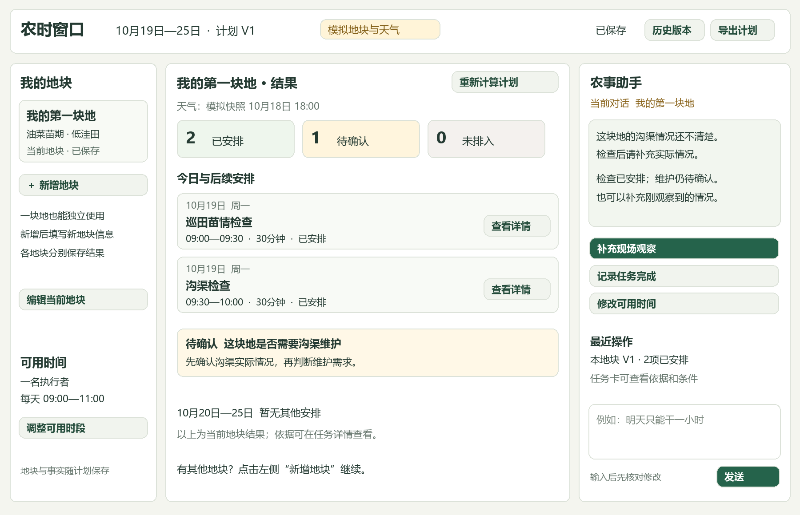

# 农时窗口终稿产品设计说明

版本 1.2 范围同步工作稿　2026年10月20日　依据A01原件对齐；未代替团队签认

## 01 产品目标与终稿边界

农时窗口面向自行管理少量地块的种植户或小型合作社管理者。用户告诉系统地块情况、想做的事情和可用时间，系统结合可追溯资料与天气信息，整理未来七天的安排；现场情况或人员时间变化后，保留已完成记录，解释哪些任务需要调整。

终稿应呈现为一个“以七天计划为中心、可对话修改的农事工作台”。用户第一眼能看到今天做什么、哪些事情还不能确定、为什么这样安排，并能直接反馈结果。对话、表单和计划操作共用一份地块与任务状态。

本文给出建议采用的终稿产品规格，供许继哲、金麟哲和李思默评审。它不代表功能已经实现，也不替代原任务清单、规则采用记录或专业农业复核。工程子任务仍由金麟哲组织分配。

### 核心范围

| 维度 | 终稿要求 |
| --- | --- |
| 地区与作物 | 湖北油菜；用户明确确认处于苗期，日期不能代替生育期确认 |
| 地块数量 | 默认提供一块空白地块表单，完成后即可获得该地块结果；按需新增，不设三块上限。三块地仅为测试样例规模，容量另行实测 |
| 核心事项 | 巡田苗情检查、沟渠检查维护；检查与实际维护分别建任务 |
| 其他待办 | 本轮暂缓其他个人待办入口及排程，后续另立扩展任务 |
| 排程模式 | 每地独立排程；联合排程暂缓；各地计划未统筹共享时间，不代表合并后可执行 |
| 劳动力模型 | 终稿默认一名执行者、多个可用时段，任务连续完成且不拆分。多人并行为后续扩展；“人力减少”在本版表现为可用时段缩减 |
| 技术基础 | 沿用 Python、Streamlit、SQLite；一个主智能体调用天气、资料检索和排程工具 |
| 暂不纳入 | 药剂处方、精确施肥用量、多作物、复杂机械与多人调度、硬件接入、遥感处理、模型训练 |

### 用户完成一次使用后的所得

一份可执行或明确标出缺项的七天计划；每项任务都有日期或未排入原因、预计时长和依据入口；一次反馈产生可对比的新版本。系统不承诺最佳农时、增产或节肥。

终稿成立的重点是完整流程能用、依据可查、变更可信。候选规则尚未采用时，系统始终显示开发验证标记，不将演示结果展示成已验证的生产指导。

---

## 02 完整使用流程

### 首次打开

首页默认呈现“我的第一块地”空白表单，尚未保存时只是草稿，不预填真实农情。填写后即可生成该地块结果，无须添加其他地块。“体验示例”为次级入口，模拟档案与真实使用记录隔离。

首次使用依次填写这块地的位置、生育期和相关农情，说明需求，查看建议、依据和待确认项。需要具体日程时，再补计划起点、可用时间和任务时长。默认从明天排起，可改为今天；今天只使用尚未过去的时段，日期均按北京时间展示。

点击“新增地块”打开新的空白表单，保存后生成新增地块的独立结果。原地块档案和结果保持不变；切换地块即可回看。仅有一块地也能完成建议、排程和反馈的完整流程。

多块地默认分别查看结果，各自独立排程。每份计划须提示“尚未统筹其他地块时间，不代表合并后可执行”。本轮暂缓联合排程，不提供跨地块共享时间统筹承诺。

### 从一块地开始的演示故事

| 步骤 | 用户行为 | 系统必须出现的结果 |
| --- | --- | --- |
| 建立计划 | 填写第一块油菜苗期田，希望安排下周工作 | 仅凭这一块地进入分析；展示建议、依据和必要追问 |
| 补齐缺项 | 一号田沟渠情况选择“不知道” | 保留未知；提出检查候选，不把未知直接写成堵塞或维护需求 |
| 看初版 | 确认可安排条件和任务时长 | 生成 V1；展示已安排、待确认和未排入事项，不为填满日历增加任务 |
| 新增地块 | 点击新增，填写二号田信息 | 生成二号田独立结果，不覆盖一号田；提示各地计划尚未统筹共享时间 |
| 反馈检查 | “一号田巡田完成，发现沟口堵塞” | 分别记录完成事实和观察；核对维护条件，询问是否安排维护及预计耗时 |
| 调整时间 | “明天只能干一小时” | 预览 V2 差异；仅在约束需要时调整未完成任务，解释原因 |
| 确认调整 | 点击“采用这版安排” | 保存新版本，旧版本可查看；已完成记录保留 |

以上是交互示例，地点、时长和观察不构成真实农情。示例演示与真实天气运行分别验证，录屏时显示数据模式。

### 完成标准

用户无需理解规则编号或 JSON，即可完成输入、查看依据、记录反馈、采用调整计划四项操作。遇到未知和失败时，有明确下一步；无需重新填写整份档案。

系统允许先形成部分计划。某块田缺少生育期或作业条件，只阻止受影响事项进入确定安排；其他已满足条件的任务可以继续计算。

---

## 03 页面结构与视觉规格

首次进入显示一块地的表单；出结果后进入“左侧地块、中间当前地块结果、右侧助手”。桌面三栏约占 20%、52%、28%；窄屏改用页签。当前选中地块清楚可见，对话默认作用于选中地块。

图为低保真布局规格，全部数据为模拟；按钮和卡片说明期望交互，不代表已实现功能。

### 各区域职责

顶栏显示日期、模式、版本和保存状态；提供切换计划、历史与导出。

左栏最初仅有一个地块，提供新增和切换入口；本轮不要求联合排程入口。

中栏显示当前地块的建议、依据、缺项和七天安排；切换地块保留各自结果。

右栏呈现追问、回答、处理进度和对话；用户可纠正识别结果或提交反馈。

任务详情用侧栏或对话框展示时间、状态和原因，提供完成、修改、查来源入口。

### 显示规则

背景浅暖灰，内容区白色，主要按钮深绿。正常、待确认、不可作业用绿、琥珀、灰红色，并配文字。使用系统中文无衬线字体，正文至少 14 px，主要操作约 16 px。

同一时刻突出一个下一步按钮。规则编号、文件哈希和调试信息收进详情；主界面使用“沟渠情况还不清楚”等具体文案。

---

## 04 输入与缺项追问

用户可从对话、地块表单和任务卡发起操作。对话识别后形成待确认修改，展示“我理解为……”及具体字段；用户确认后写入档案。同一事实只问一次，只有信息过期、矛盾或新变化影响原确认时才重新询问。

| 信息组 | 最小内容 | 缺失时的处理 |
| --- | --- | --- |
| 地块身份 | 名称、湖北内位置、作物、生育期确认 | 缺地区或生育期时不作确定适用判断 |
| 天气位置 | 城市／县或乡镇选择、天气查询点 | 同名地点让用户选；显示查询位置，不能默默选第一个 |
| 田块情况 | 田型；与当前任务有关的积水、沟渠、干湿观察 | 允许“不知道”；只追问会改变当前决策的字段 |
| 待办需求 | 用户想做什么、检查或维护需求 | 有依据只能产生候选；不能由文献自动推定现场需要 |
| 时间资源 | 起点、每日可用时间、单任务预计时长 | 不按面积擅自估工时；提供可编辑示例，不自动当用户确认 |
| 作业条件 | 对具体任务与日期的现场、天气条件确认 | 未知保持待确认；支持按明确日期范围批量确认 |

面积作为档案信息保留，缺失时不阻止不依赖面积的检查排程。叶片数、冬前情境等仅在对应规则确实需要时询问。只追问当前地块相关信息；不要求先录完全部地块或一整周所有农情才能出结果。

### 追问样例

“二号田的沟渠情况还不清楚。你希望先安排一次检查吗？”选项为“先检查”“我知道情况，补充一下”“暂不安排”。选择先检查后，再确认检查本身所需的进入条件和预计时间。

“你说的‘明天只有一小时’是指 2026年10月20日。保留 09:00—10:00，还是改成其他时段？”如果只知道总时长，不得擅自选具体钟点。

一次集中呈现最多三个相关问题；每个问题提供“未知／暂时跳过”。跳过影响排程时说明受影响任务，避免反复询问同一问题或卡住整份计划。

### 数据提交原则

表单编辑先显示未保存状态，离开时保留草稿。用户反馈事实与“采用新计划”分开：确认完成或观察即保存为事件；排程调整先预览。取消调整不会撤销已经确认的现场事实，旧计划显示“待更新”。

---

## 05 主智能体的职责与行为

主智能体将自然语言转成受校验的操作，选择工具、组织追问并解释结果。农业条件和时间计算由规则与程序约束。文字说明必须引用工具返回的任务、状态和证据，不能另写一份与计划表不同的安排。

| 阶段 | 智能体行为 | 程序提供的约束 |
| --- | --- | --- |
| 理解 | 识别建档、计划、解释、反馈、修改请求 | 输出限定类型及字段；不识别就澄清 |
| 确认 | 将模糊称呼、日期和修改解释给用户 | 检查地块 ID、日期范围、值域及矛盾 |
| 补齐 | 只询问影响本次结果的缺项 | 返回 required_fields 与原因，未知不变成 false |
| 获取 | 查询天气，筛选农业资料 | 返回来源、适用条件、时间戳与失败状态 |
| 计算 | 调用候选判断和排程工具 | 校验任务必要性、窗口、工时、前置关系 |
| 解释 | 用简短文字说明安排与未排入原因 | 从同一结果对象生成任务卡和解释 |
| 调整 | 解析反馈，生成变更预览 | 锁定完成记录、比较版本、检查保存冲突 |

### 三个核心工具的产品契约

天气工具接收查询位置、日期范围，返回逐日数据、数据源、获取时间、预报覆盖期及可用状态。资料工具接收地区、作物、阶段、田型和问题，返回相关原文、适用与不适用条件、来源年份、规则采用状态。排程工具接收已确认事实、候选任务、作业条件、可用时段及旧版本，返回计划、缺项、冲突和差异。

内部可拆出校验和持久化模块，但不增加多个角色 Agent 的演示负担。工具参数必须在调用前校验，返回值也必须校验；模型不能直接改 SQLite 或把自然语言当数据库命令。

### 用户看到的处理过程

显示“正在检查地块信息”“已取得天气”“正在核对任务条件”“正在计算安排”等真实步骤。完成后展示简短结果摘要，不展示模型私有推理过程，也不伪造进度、工具调用或成功状态。

模型失败时提供重试和结构化录入入口，保留草稿。若已有完整的确认输入，可以运行确定性工具，并明确提示对话服务暂不可用。模型服务商、具体型号和费用上限仍由工程负责人选择，本文不预设购买决定。

---

## 06 农业判断与状态设计

把适用性、必要性、每日作业窗口和排程结果分别保存。界面默认显示最需要用户处理的一条原因，详细页展示四层判断，避免把“没时间做”显示成“农业条件不适宜”。

| 层次 | 可选状态 | 典型表现 |
| --- | --- | --- |
| 资料适用性 | 适用／待确认／超出范围 | 生育期未知时不能确认苗期规则适用 |
| 任务必要性 | 需要／不需要／未知 | 沟渠状态未知，不直接新增确定维护任务 |
| 每日作业窗口 | 可安排／暂不可安排／待确认 | 现场或天气条件明确不满足则不可安排；关键条件缺失则待确认 |
| 排程结果 | 已安排／未排入／待确认／已完成／已取消 | 窗口可行但工时不足，显示未排入及工时原因 |

取消只取消未完成待办，保留记录与取消原因。完成事件不能被模型重写；误报完成通过用户明确发起的更正事件处理，原事件继续留存。

### 从候选到确定任务

巡田和沟渠检查可以用于补充未知信息，但检查任务本身仍需用户需求及进入条件。实际维护需要符合采用规则的适用范围、明确现场问题和维护需求。用户仅表示“担心堵塞”，不等于已经观察到堵塞。

同一块田上的检查与维护使用不同任务 ID，可声明前置关系。前置检查未完成、维护事实尚未确认时，可以展示维护候选，不能假定检查一定会发现问题并提前承诺维护。

### 规则采用流程

当前融合资料共 31 张 C 卡，首版候选为 C11、C18、C19、C20、C23、C24、C31。候选卡默认未自动启用。终稿需新增独立采用记录，保存审核人、日期、适用范围、版本和结论；不通过修改原件伪装既有农业审核。

开发验证模式可运行标记清楚的候选规则；生产指导所需的适用复核未完成时，结果持续标记“开发验证，适用性待复核”。往年资料保留年份与条件，不把年份改成当年。

任何降雨提示都不能直接等同于田面积水或不可进入。没有经采用的明确条件规则时，天气用于提示风险和触发确认，不能由模型发明一个通用毫米阈值。

---

## 07 七天计划与任务详情

结果区默认展示当前地块，含建议、依据、缺项及按日分组的七天安排。未填写时间资源时先给建议，不填造钟点；没有任务的日期写“暂无安排”。结果仅对应当前地块；新增地块不改动其他地块已采用的计划，独立计划持续显示跨地块时间未统筹提示。

| 任务详情字段 | 产品要求 |
| --- | --- |
| 地块与任务 | 可辨识名称，区分检查与维护 |
| 日期与时间 | 已排任务显示开始和结束；待确认不填假时间 |
| 预计时长 | 分钟，来源为用户估计；修改后重算 |
| 窗口与执行状态 | 分开显示可安排性和是否已排／已完成 |
| 安排原因 | 简述触发条件、优先级或约束 |
| 农业依据 | 原文、出处、日期、适用限制入口 |
| 待确认项 | 缺什么及补充入口，已齐全则不占大段空间 |
| 调整原因 | 发生移动、移出或新增时显示；可跳转版本对比 |

### 排程规则

先检验适用性、任务需求和逐日作业条件，再安排时间。任务不能超出单人可用时段、与其他任务重叠或违反前置关系；不可拆分的任务必须有完整连续时段。用户目标日期与农业依据要求分开保存，不能把用户希望的日期描述成科学最佳日期。

建议首轮排序依次考虑用户确认的优先级、目标期限、较早的可行时段，最后以稳定任务 ID 打破并列。重排先锁定已完成任务，再保留仍符合约束的原安排，最后处理受影响任务。冲突时硬约束优先于少移动，所有移出和移动都有原因。

窗口可行但放不下时，保留任务并说明“需要连续 90 分钟，当前最长可用时段 60 分钟”。用户可以增加时间、调整优先级或修改经自己确认的估计时长；系统不能为了塞入任务偷偷缩短工时。

### 用户修改计划

终稿使用“修改日期／时长／优先级”的明确入口，保存前重新校验。拖拽排程暂缓，减少难以解释的非法移动。修改日期不等于自动确认当天可作业；若该日条件未知，应转入待确认。

导出当前计划为可读清单和结构化文件，包含版本、数据模式、日期、任务、未排入原因及证据编号。不能只导出成功排入的部分，遗漏缺项和冲突。

---

## 08 反馈重排与版本对比

反馈入口支持“记录完成”“补充现场情况”“修改可用时间”和自然语言。提交前显示涉及地块、日期和事实；含多个事项的句子拆成独立修改供核对。完成时间不明确时询问，不默认全部任务都已完成。

### 变更预览的结构

先说明本次输入，再展示新增、移动、移出、取消和保持不变的任务。每行包含原安排、新安排与原因。已完成记录单列为保留项；没有差异时显示“当前安排无需调整”，不制造空白新版本。

| 模拟变化 | 原记录 | 预览结果 | 必须说明的原因 |
| --- | --- | --- | --- |
| 一号田巡田完成 | 10月19日 09:00—09:30 | 已完成并锁定 | 用户确认完成，后续排程保留 |
| 明天时段缩减 | 二号田维护需连续 90 分钟 | 移到后续已确认可行日期；若无则未排入 | 10月20日只剩 60 分钟 |
| 新增堵塞观察 | 二号田沟况未知 | 维护候选待确认 | 需核对适用范围、维护需求与时长 |
| 新观察影响进田条件 | 后续日期此前可作业 | 受影响日期转待确认 | 旧确认可能失效，明确不适宜记录不被反向覆盖 |

### 保存与历史

“采用这版安排”保存新计划版本、所用输入快照、规则版本、天气快照及修改原因。查看旧版默认只读；恢复旧安排应以当前事实重新校验后生成新版本，不能覆盖已经完成的工作。

重复点击、网络重试或页面刷新不能产生重复完成事件和重复计划。提交携带原版本号，若另一操作已更新计划，提示刷新并重新预览，避免旧结果覆盖新事实。

### 事实与安排分开保存

已确认的反馈是事实记录；计划是基于事实的安排。反馈已保存、重排失败时，显示“反馈已保存，计划待更新”，并可重试。用户不能因为取消重排而丢失刚记录的堵塞或完成情况。

重排前后可追溯到同一任务。只有新增真实待办才产生新任务 ID，不能每次生成计划都把旧任务改名后复制一份。

---

## 09 天气与资料依据的呈现

### 天气只表达它实际提供的信息

计划顶部显示查询位置、逐日天气摘要、来源、获取时间和覆盖日期。若地块共用同一个查询点，明确写出；不能让用户误以为每块田都有实测设备。未来预报、用户观测和模拟数据使用不同标签。

天气可能触发“请确认田间是否积水、是否能够进入”的问题，但不会替代现场观察。用户选择一段日期的作业条件时，界面显示完整范围和确认依据，不提供默认全周可作业的快捷操作。

实时获取失败时：存在缓存则显示缓存时间及失效状态；过期缓存只能作为历史参考。天气过期阈值作为显式产品配置，建议初值 6 小时，仅表示产品刷新策略，不表示预报科学有效期。缺少所需日期数据的任务保留待确认，可继续处理不依赖该数据的操作。

### 点开依据应看到什么

任务详情先给一句“这条资料与本任务的关系”，再列原文短摘、发布机构、发布日期、文档标题、PDF 页码、适用地区和生育期、限制条件。提供打开包内原件或来源网页的入口；没有有效链接时可通过文档名和页码定位。

资料检索必须保留不匹配原因。地区、阶段、田型或任务条件不符的条目不能只因关键词相近就支持确定建议。检索不到时如实说明“当前资料不足以支持这项建议”，保留用户待办并指出缺少哪类依据。

### 对建议和排程分别解释

“为什么建议检查沟渠”由适用农业资料和现场情况解释；“为什么安排在周二上午”由可行窗口、可用时间与排序规则解释。不能让同一条农业引用看起来支持了程序自行选择的具体时刻。

### 可复现记录

每次计划绑定资料包版本、采用记录、天气快照和已确认输入。开发日志另外记录工具调用状态和模型版本，供测试与报告使用。网页首屏不展示密钥、原始异常或完整调试日志。

本地 SQLite 继续承载示范数据。若后续部署到公网，需另行设计访问隔离与数据保护，不能将共享演示数据库直接当作多人产品上线。

---

## 10 空白页与异常交互

| 情况 | 用户看到的内容 | 可继续的操作 |
| --- | --- | --- |
| 尚无地块 | 第一块地的空白表单，示例为次级入口 | 填一块地即可获得结果 |
| 地区或阶段不支持 | 说明本版适用范围和不匹配项 | 更正信息；保留档案，不强行给建议 |
| 农情未知 | 缺项问题及受影响任务 | 回答、先检查或暂不安排 |
| 相互矛盾的信息 | 展示旧记录、新输入和各自时间 | 用户选当前事实，保留修改历史 |
| 天气或模型失败 | 具体服务状态、保留的输入与缓存时间 | 重试或切结构化操作；不伪造结果 |
| 资料不足 | 当前依据不足及缺失范围 | 查看资料、保留待办，不给确定处置 |
| 全周排不下 | 待办清单、工时和前置冲突 | 改可用时间或任务约束，重新计算 |
| 保存失败 | 明确“尚未保存”，草稿仍在 | 重试，旧版本可查看 |
| 生成中又修改输入 | 提醒当前结果基于哪版输入 | 旧结果标记过期，按新输入重算 |
| 无须重排 | 哪些条件变化但未影响安排 | 保留当前计划，反馈仍有记录 |

### 文案与可用性

错误放在受影响字段旁边，写清如何修正，如“结束时间需要晚于开始时间”。页面顶部的总错误只负责定位，不重复整段技术报错。生成过程保持已填内容可见；按钮防重复提交，长操作可以退出等待并在返回后恢复状态。

加载示例、清空草稿和取消未完成任务只在确有覆盖或删除影响时确认；普通查看、切换页签和展开依据不弹确认框。所有状态、输入和按钮支持键盘访问，并有清晰文字标签。

### 响应目标

本地排程以三块地、七天作为性能样本，目标 2 秒内完成；三块不构成产品上限。另测单块及更多地块，按实测确定容量。联网生成目标为 20 秒内返回结果或失败说明。以上尚未实测，超时显示真实阶段，不伪造成功。

记录测试机器、网络、模型版本和样本数，分别报告本地计算与端到端耗时。若实际表现达不到目标，先减少重复检索和调用，再据实调整范围，不在材料中写成已达到。

---

## 11 终稿验收与演示脚本

### 发布前必须通过的产品验收

| 编号 | 验收场景 | 通过条件 |
| --- | --- | --- |
| A01 | 首次打开仅填一块地 | 默认一个空白表单，独立产出结果；示例隔离且标注模拟 |
| A02 | 自然语言输入地块、时间和修改 | 正确抽取并可校正；缺关键项先问，未知不被填造 |
| A03 | 新增及切换多块地 | 新地独立出结果，旧结果不丢；可添加第四块；跨地块未统筹提示清楚 |
| A04 | 不足以支持维护的现场信息 | 不产生确定维护安排，指出缺项或检查入口 |
| A05 | 天气正常、失败和过期缓存 | 来源与时间可查；失败不伪造预测，不无提示使用旧数据 |
| A06 | 打开农业依据 | 可定位原文和适用条件；解释与引用相符 |
| A07 | 完成反馈后缩减时间 | 完成记录保留；新旧计划差异、移动及未排入原因正确 |
| A08 | 重复提交、刷新和版本冲突 | 无重复事件，保存失败不显示成功，旧版不覆盖新版 |
| A09 | 用户自建其他待办 | 本轮暂缓，不列入本轮必过验收 |
| A10 | 导出与恢复访问 | 导出含模式和版本；刷新后档案、反馈及历史仍可查看 |

继续执行原验证设计：12 组开发案例、30 个独立留出案例、6 个边界案例各运行 3 次；A 直接生成、B 加检索、C 完整系统使用相同输入、模型设置和天气快照。两人独立核对参考预期，保留失败结果。

至少 5 名体验者中 4 人独立完成输入、查来源、反馈、查看新计划。体验者身份如实记录。程序测试、体验测试与农业专业复核分别报告；当前已有单元测试通过不等于终稿验收通过。

### 四分钟演示建议

前 30 秒说明用户问题；30—90 秒填写一块地并完成关键追问；90—150 秒看该地结果和依据，再新增第二块地展示独立结果；150—210 秒演示反馈与调整；最后 30 秒查看历史和实测结果。演示逐地独立结果及限制提示，固定数据全程标为模拟。

演示应能从正常界面完成，无须开发者临时改数据库或跳过错误。外部服务失败有明确备用演示入口，不能把固定演示冒充实时调用。

---

## 12 从初稿到终稿的实施顺序

本地初稿已具备规则加载、结构化输入、确定性排程、反馈和 SQLite 历史记录。现有界面仍以表单和开发验证为中心，未连接真实模型与天气。以下为基于本地代码与 README 的设计映射，未声称远端此刻没有新增提交。

| 工作包 | 对现有基础的处理 | 交付检查点 |
| --- | --- | --- |
| 统一领域对象 | 复用现有模型，解除固定地块数，绑定各地块独立结果 | 地块 ID 动态生成，单块可用，新增不覆盖，未知与 false 区分 |
| 主流程交互 | 单地块表单起步，结果居中，按需新增与追问 | 单块完整闭环；多块逐一出独立结果，显示共享时间未统筹提示 |
| 接工具与模型 | 沿用 rules 与 planning_v2，增加条件检索、天气、编排 | 真正调用工具并校验；文字解释与计划一致 |
| 反馈与持久化 | 扩展 repository 与反馈流程 | 事实先存、计划预览、版本对比、重复提交保护 |
| 验收与冻结 | 复用已有测试，再补终稿端到端用例 | 留出、对照、体验记录齐全；失败与限制可复现 |

### 推荐开发顺序

第一步在本说明上确认范围、核心规则采用口径与状态模型，同时画出主界面。第二步用固定输入完成“建档—追问—V1—反馈—V2”的完整交互，保留模拟标签。第三步接真实模型、天气和条件检索，验证它们使用同一套业务对象。第四步补齐失败、保存与冲突路径，执行独立评测和录屏。

“直接奔着终稿做”意味着按同一份最终规格逐步完成，每一步都能融入终稿。已有正确的排程、规则和历史逻辑继续利用；是否拆分模块由金麟哲依据实际代码决定。

### 本轮需要团队定下的事项

本轮按A01原件采用湖北油菜苗期、单地块起步、按需新增、一名执行者及每地独立排程；联合排程和其他个人待办暂缓。独立计划不保证合并可执行。模型配置、部署方式、规则采用及团队签认按实际记录维护。

上述新增建议仍需团队评审，不视为三人全部同意。原任务清单继续作为唯一进度表。版本 1.1 修正了将“三块测试地”误写成产品数量限制的问题。

### 设计依据与版本维护

依据为仓库内《农时窗口项目说明》20261016、《任务清单优化版》20261016、README、src/nongshi 下 app_v2、schema_v2、planning_v2、rules、repository，以及融合修订版规则阅读说明。本说明细化页面、行为与验收，不改动原始资料或应用代码。

Markdown 为后续维护源，Word 为本次评审快照。改动后同步版本号与日期；涉及范围、状态语义或验收标准时，记录变更原因。规则采用记录和实验结果分别维护，不回填到设计文档中冒充既有成果。
